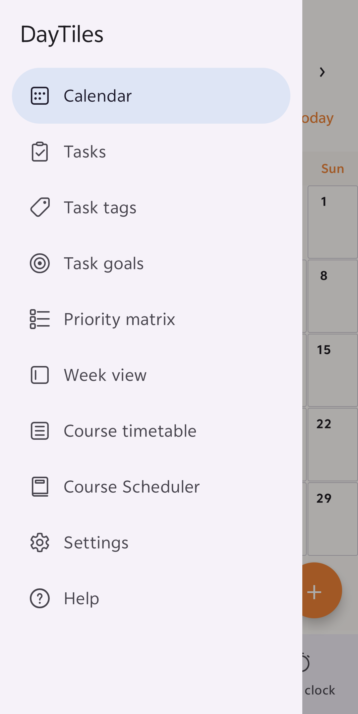
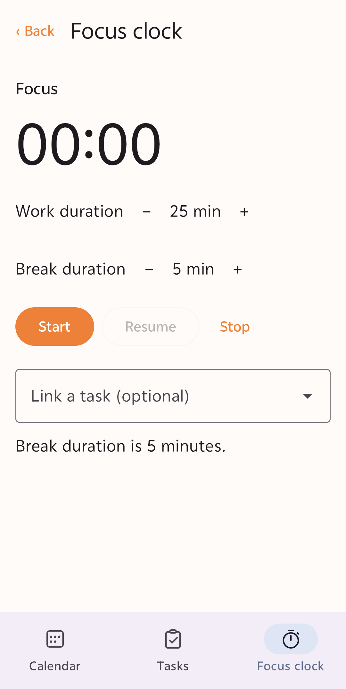
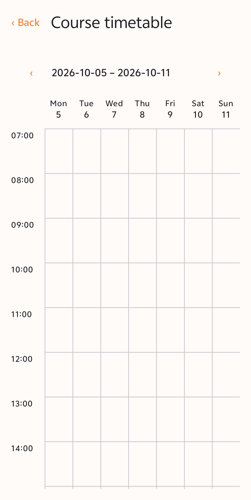
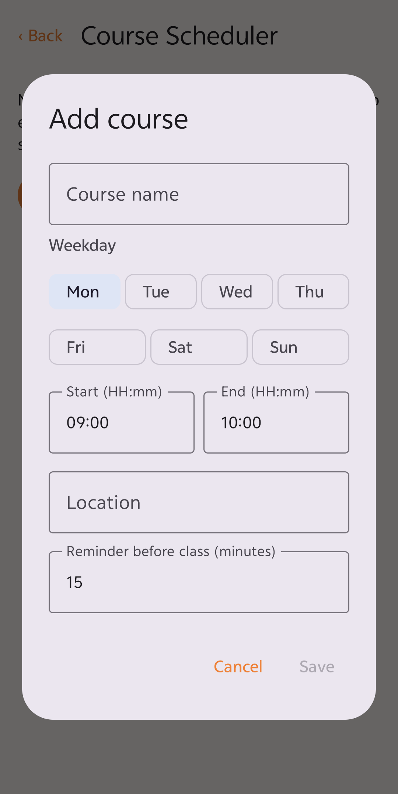

# DayTiles

DayTiles is a free, open-source, offline-first Android calendar, journal, and visual planner. The month calendar is the home for dated notes, stickers, and checkable tasks. The app is built with Kotlin, Jetpack Compose, Room, and Material 3.

## Screenshots

Screenshots are from the Android app with system status and navigation bars cropped out. Sample views below avoid showing personal journal or task content.

<table>
  <tr>
    <td align="center"><strong>Month calendar</strong><br></td>
    <td align="center"><strong>Navigation drawer</strong><br></td>
  </tr>
  <tr>
    <td align="center"><strong>Focus clock</strong><br></td>
    <td align="center"><strong>Course timetable</strong><br></td>
  </tr>
  <tr>
    <td align="center"><strong>Course Scheduler</strong><br></td>
    <td align="center"><strong>Add a course</strong><br></td>
  </tr>
</table>

## Features

- Full-height month calendar with month navigation, a Today shortcut, and selectable dates
- Daily journal entries stored separately from tasks and stickers, with automatic saving
- Dated tasks with a dedicated full-screen create/edit form for title, details, tags, and optional reminder alarms
- Ordered, checkable subtasks on tasks, with completion progress and data-preserving Room migration
- Daily and weekly completed-task targets with progress bars and goal punch-card counts
- Optional importance/urgency classification with a separate four-quadrant priority matrix
- Task completion, deletion, due-date grouping, tag filtering, and overdue indicators in the task overview
- Day editor popup focused on journal text and sticker management; add/remove stickers independently of task workflows
- Built-in emoji stickers, custom emoji input, local PNG/WebP imports, and optional HTTPS PNG/WebP downloads
- Reusable sticker library with date-specific sticker placements and calendar-cell previews
- Calendar, Tasks, and Focus bottom navigation, including a date-grouped task list
- Side navigation for calendar, tasks, tags, goals, priority matrix, week view, course timetable, Course Scheduler, focus clock, settings, and help
- Week-at-a-glance screen showing tasks and journal snippets
- Weekly course timetable with day columns, time slots, week navigation, and colored class blocks
- Separate Course Scheduler to add, edit, and remove recurring courses, with weekday, time, location, and optional local reminders
- Configurable focus clock with pause/resume, automatic break phase, optional task association, persistent notification, and widget start
- Five resizable Android home-screen widgets with compact and expanded layouts:
  - Todo list with open tasks, due dates, reminder times, and completion actions
  - Daily journal preview with a one-tap editor for today's entry
  - Compact localized month calendar with today's date highlighted
  - Week overview with dated tasks and journal previews
  - Focus clock for starting/checking a focus session
- English as the default language and Simplified Chinese (`zh-CN`) localization
- Offline-first storage, with no account, ads, analytics, tracking, cloud sync, or backend

## Features in detail

### Task organization

- **Subtasks** — ordered, checkable child tasks with completion state and parent progress. Existing tasks are preserved through Room migrations.
- **Task targets and aims** — daily and weekly completion goals with progress indicators and punch-card counts. Goal records are separate from journal entries and tasks.
- **Four-quadrant prioritization** — optional importance/urgency classification shown in a dedicated priority matrix. Tasks remain uncategorized until the user assigns a priority.

### Navigation and planning

- **Side menu** — access calendar, tasks, tags, goals, priority matrix, week view, course timetable, Course Scheduler, focus clock, settings, and help.
- **Week view** — see dated tasks and journal snippets, with a compact week-view widget.
- **Course timetable** — scan recurring classes in a weekly, time-based grid with weekday columns and colored course blocks.
- **Course Scheduler** — independently manage recurring courses: create, edit, or remove a course and set its weekday, time, location, and optional local reminder.

### Focus and home-screen widgets

- **Focus clock** — offline timer with configurable focus/break durations, pause/resume, persistent notification, and optional task association.
- **Focus clock widget** — start or check a focus session from the home screen.
- **Widget layout options** — todo, journal, month, week, and focus widgets resize and adapt their content to compact or expanded sizes.

## Build and test

Requirements:

- JDK 17 or newer
- Android SDK 37
- Android SDK Build Tools 36.0.0
- The checked-in Gradle Wrapper (no system Gradle installation required)

Run the verification tasks from the project root:

```shell
./gradlew assembleDebug
./gradlew testDebugUnitTest
./gradlew lintDebug
```

The debug APK is written to `app/build/outputs/apk/debug/app-debug.apk`. Dependency versions are centralized in `gradle/libs.versions.toml`.

## Project structure

```text
app/src/main/java/com/december172/daytiles/
├── data/              # Room persistence and repositories
├── domain/model/      # Independent journal, task, and sticker models
├── widget/            # Android home-screen widgets
└── ui/
    ├── calendar/      # Month state, date algorithms, and calendar UI
    ├── day/           # Daily journal and task editor
    └── theme/         # Material 3 theme
```

## Privacy and connectivity

DayTiles works offline. Internet access is used only when the user explicitly downloads a sticker from a URL; downloaded stickers are kept in private local storage. There are no accounts, advertisements, analytics, tracking, cloud services, or backend dependency.

## Credits

- December172 — project creator and maintainer
- OpenAI Codex / ChatGPT — development collaboration, implementation, testing, and documentation
- Fluent System Icons by Microsoft — navigation icons, from the [Fluent UI System Icons](https://github.com/microsoft/fluentui-system-icons) project; see [third-party licenses](THIRD_PARTY_LICENSES.md)

See [CONTRIBUTORS.md](CONTRIBUTORS.md) for contribution details.
