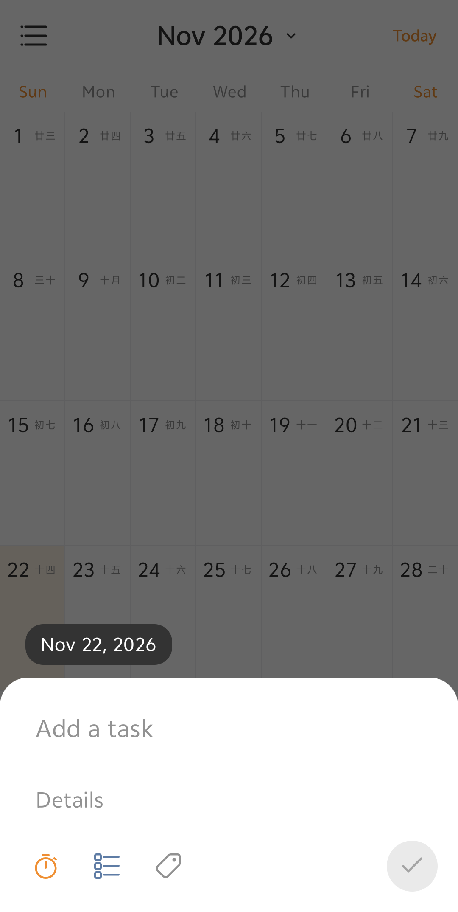
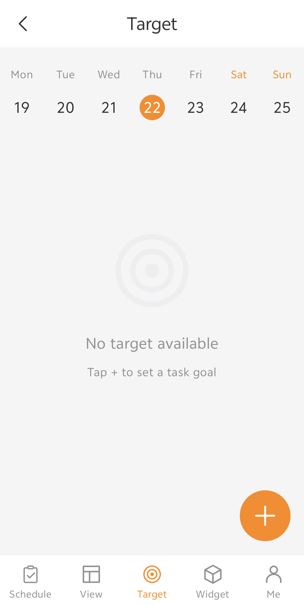
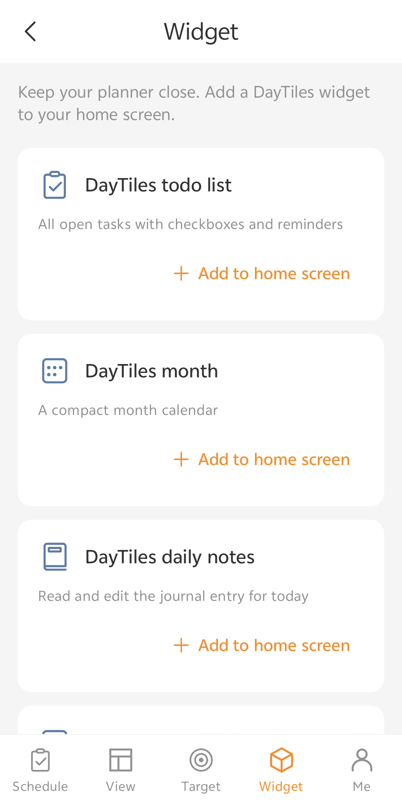
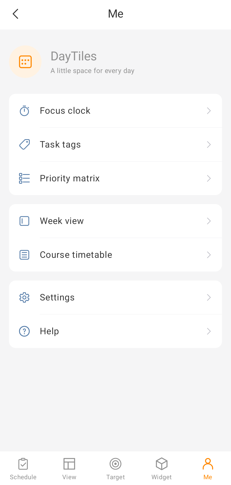
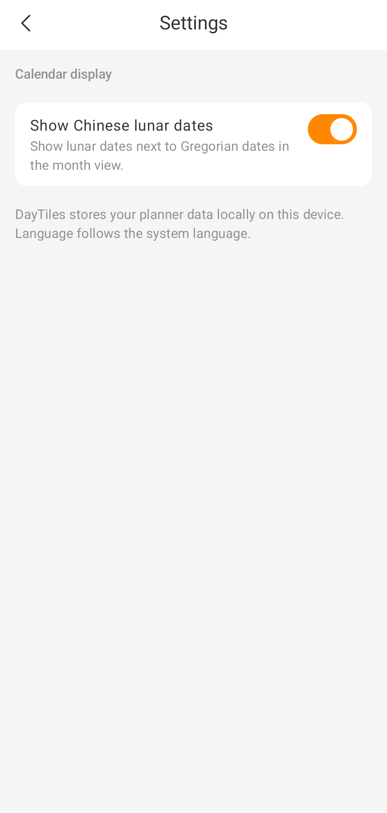

# DayTiles

[English](README.md) | [简体中文](README.zh_CN.md) | [繁體中文（香港）](README.zh_HK.md) | [繁體中文（台灣）](README.zh_TW.md)

DayTiles is a free, open-source, offline-first Android calendar, journal, and visual planner. The month calendar is the home for dated notes, stickers, and checkable tasks. The app is built with Kotlin, Jetpack Compose, Room, and Material 3.

## Screenshots

Screenshots are from the Android app with system status and navigation bars cropped out. Sample views below avoid showing personal journal or task content.

<table>
  <tr>
    <td align="center"><strong>Month calendar</strong><br></td>
    <td align="center"><strong>Quick task entry</strong><br></td>
  </tr>
  <tr>
    <td align="center"><strong>Navigation drawer</strong><br></td>
    <td align="center"><strong>Targets</strong><br></td>
  </tr>
  <tr>
    <td align="center"><strong>Widget catalogue</strong><br></td>
    <td align="center"><strong>Planning tools</strong><br></td>
  </tr>
  <tr>
    <td align="center"><strong>Course timetable</strong><br></td>
    <td align="center"><strong>Calendar settings</strong><br></td>
  </tr>
</table>

The [reference appearance milestone](docs/redesign.md) documents the redesign,
verification, and remaining visual differences.

## Features

- Full-height, Sunday-first month calendar with swipe navigation, a month picker, offline lunar dates, a Today shortcut, and selectable dates
- Daily journal entries stored separately from tasks and stickers, with automatic saving
- Dated tasks with a bottom quick-entry panel and a full-screen editor for title, details, tags, subtasks, and optional reminder alarms
- Ordered, checkable subtasks on tasks, with completion progress and data-preserving Room migration
- Daily and weekly completed-task targets with a week strip, goal editor, progress bars, and goal punch-card counts
- Optional importance/urgency classification with a separate four-quadrant priority matrix
- Task completion, deletion, due-date grouping, tag filtering, and overdue indicators in the task overview
- Day editor popup focused on journal text and sticker management; add/remove stickers independently of task workflows
- Built-in emoji stickers, custom emoji input, local PNG/WebP imports, and optional HTTPS PNG/WebP downloads
- Reusable sticker library with date-specific sticker placements and calendar-cell previews
- Schedule, View, Target, Widget, and Me bottom navigation, including a date-grouped task list with circular completion controls
- Grouped local planning tools and an in-app widget catalogue with confirmed placement feedback, retry, and manual-add instructions
- Side navigation for calendar, tasks, tags, goals, priority matrix, week view, course timetable, focus clock, settings, and help
- Week-at-a-glance screen showing tasks and journal snippets
- Unified weekly course timetable with day columns, time slots, week navigation, colored class blocks, and course management; add from an empty slot or edit a class directly
- Persistent setting to show or hide Chinese lunar dates in the month calendar
- Configurable focus clock with pause/resume, automatic break phase, optional task association, persistent notification, and widget start
- Five resizable Android home-screen widgets with compact and expanded layouts:
  - Todo list with open tasks, due dates, reminder times, and completion actions
  - Daily journal preview with a one-tap editor for today's entry
  - Compact localized month calendar with today's date highlighted
  - Week overview with dated tasks and journal previews
  - Focus clock for starting/checking a focus session
- English as the default language, with Simplified Chinese (`zh-CN`) and Traditional Chinese for Hong Kong (`zh-HK`) and Taiwan (`zh-TW`)
- Offline-first storage, with no account, ads, analytics, tracking, cloud sync, or backend

## Features in detail

### Task organization

- **Subtasks** — ordered, checkable child tasks with completion state and parent progress. Existing tasks are preserved through Room migrations.
- **Task targets and aims** — daily and weekly completion goals with progress indicators and punch-card counts. Goal records are separate from journal entries and tasks.
- **Four-quadrant prioritization** — optional importance/urgency classification shown in a dedicated priority matrix. Tasks remain uncategorized until the user assigns a priority.

### Navigation and planning

- **Side menu** — access calendar, tasks, tags, goals, priority matrix, week view, course timetable, focus clock, settings, and help. Week view appears once in the drawer's shortcut row.
- **Week view** — see dated tasks and journal snippets, with a compact week-view widget.
- **Course timetable** — view and manage recurring classes in one weekly grid. Tap an empty time slot or + to create a course; tap a class to edit or delete it. The full-page editor sets weekday, start/end time, location, and an optional local reminder. Overlapping classes remain individually selectable, and the toolbar opens a course list within the same screen.
- **Calendar settings** — show or hide Chinese lunar date labels. The preference is stored locally and survives app restarts.

### Focus and home-screen widgets

- **Focus clock** — offline timer with configurable focus/break durations, pause/resume, persistent notification, and optional task association.
- **Focus clock widget** — start or check a focus session from the home screen.
- **Widget layout options** — todo, journal, month, week, and focus widgets resize and adapt their content to compact or expanded sizes.
- **Add to home screen** — requests the launcher's native confirmation and reports success only after its placement callback. If placement is unsupported or remains unconfirmed, the app offers retry and manual steps with an action to open the home screen. Placement requires launcher support and available space.

## Build and test

Requirements:

- JDK 17 or newer
- Android SDK 37
- Android SDK Build Tools 36.0.0
- The checked-in Gradle Wrapper (no system Gradle installation required)

Run the verification tasks from the project root:

```shell
./gradlew assembleDebug
./gradlew testDebugUnitTest
./gradlew lintDebug
```

The debug APK is written to `app/build/outputs/apk/debug/app-debug.apk`. Dependency versions are centralized in `gradle/libs.versions.toml`.

## Project structure

```text
app/src/main/java/com/december172/daytiles/
├── data/              # Room persistence and repositories
├── domain/model/      # Independent journal, task, and sticker models
├── widget/            # Android home-screen widgets
└── ui/
    ├── calendar/      # Month state, date algorithms, and calendar UI
    ├── components/    # Shared toolbars and primary navigation
    ├── day/           # Daily journal, quick task entry, and task editor
    ├── planner/       # Goals, widgets, focus clock, and planning tools
    └── theme/         # Material 3 theme
```

## Privacy and connectivity

DayTiles works offline. Internet access is used only when the user explicitly downloads a sticker from a URL; downloaded stickers are kept in private local storage. There are no accounts, advertisements, analytics, tracking, cloud services, or backend dependency.

## Credits

- December172 — project creator and maintainer
- OpenAI Codex / ChatGPT — development collaboration, implementation, testing, and documentation
- Fluent System Icons by Microsoft — navigation icons, from the [Fluent UI System Icons](https://github.com/microsoft/fluentui-system-icons) project; see [third-party licenses](THIRD_PARTY_LICENSES.md)

See [CONTRIBUTORS.md](CONTRIBUTORS.md) for contribution details.
