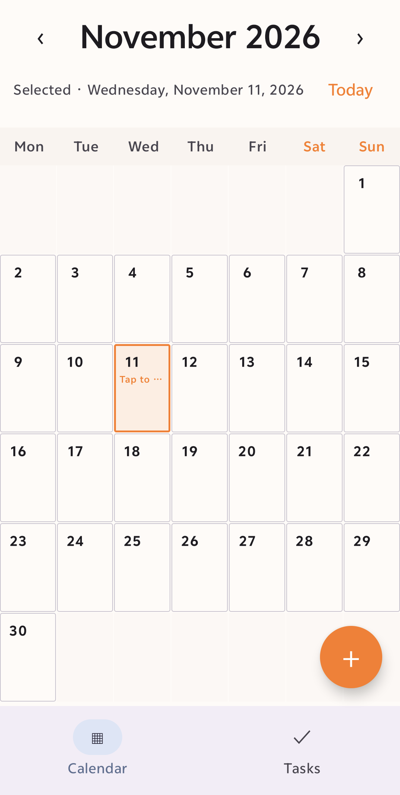

# DayTiles

DayTiles is a free, open-source, offline-first Android calendar, journal, and visual planner. The month calendar is the home for dated notes, stickers, and checkable tasks. The app is built with Kotlin, Jetpack Compose, Room, and Material 3.

## Screenshots

### Month calendar

The calendar provides a full-height month grid, date selection, and quick access to the selected day.



## Features

- Full-height month calendar with month navigation, a Today shortcut, and selectable dates
- Daily journal entries stored separately from tasks and stickers, with automatic saving
- Dated tasks with a dedicated full-screen create/edit form for title, details, tags, and optional reminder alarms
- Task completion, deletion, due-date grouping, tag filtering, and overdue indicators in the task overview
- Day editor popup focused on journal text and sticker management; add/remove stickers independently of task workflows
- Built-in emoji stickers, custom emoji input, local PNG/WebP imports, and optional HTTPS PNG/WebP downloads
- Reusable sticker library with date-specific sticker placements and calendar-cell previews
- Calendar and Tasks bottom navigation, including a date-grouped task list
- Three Android home-screen widgets:
  - Todo list with open tasks, due dates, reminder times, and completion actions
  - Daily journal preview with a one-tap editor for today's entry
  - Compact localized month calendar with today's date highlighted
- English as the default language and Simplified Chinese (`zh-CN`) localization
- Offline-first storage, with no account, ads, analytics, tracking, cloud sync, or backend

## Planned features (TODO)

The following work is intentionally split into small steps. Implement and verify one item at a time; do not bundle the whole list into one release.

### Task organization

- [ ] **Subtasks** — support a parent task with an ordered checklist of child tasks, including completion state and a clear parent progress summary. Preserve existing tasks during the Room schema migration.
- [ ] **Task targets and aims** — define daily and weekly goals (for example, a target number of completed tasks), show progress toward each goal, and provide a compact goal/punch-card view. Keep goal records distinct from journal entries and tasks.
- [ ] **Four-quadrant prioritization** — optionally classify tasks by importance and urgency, then provide a separate Eisenhower-style view. Avoid forcing this model on ordinary task entry.

### Navigation and calendar views

- [ ] **Side menu** — add a navigation drawer for secondary areas such as settings, tags, goals, and help. Keep the calendar and task list directly accessible and retain a simple small-screen experience.
- [ ] **Week view** — add a week-at-a-glance screen with dated tasks and journal snippets, then expose a compact week-view home-screen widget.
- [ ] **Schedule and recurring items** — add an optional schedule view for recurring commitments, starting with a course planner for class names, weekdays, start/end times, locations, and local reminders. Keep course sessions distinct from journal entries and tasks.

### Focus and home-screen widgets

- [ ] **Focus clock** — add an offline focus timer with configurable work/break durations, pause/resume, and a persistent notification; allow an optional link to a task.
- [ ] **Focus clock widget** — add a compact widget for starting or checking the active focus session.
- [ ] **Widget layout options** — offer useful compact and expanded variants for the existing todo, journal, and month widgets, then add the week widget when week view is available.

## Build and test

Requirements:

- JDK 17 or newer
- Android SDK 37
- Android SDK Build Tools 36.0.0
- The checked-in Gradle Wrapper (no system Gradle installation required)

Run the verification tasks from the project root:

```shell
./gradlew assembleDebug
./gradlew testDebugUnitTest
./gradlew lintDebug
```

The debug APK is written to `app/build/outputs/apk/debug/app-debug.apk`. Dependency versions are centralized in `gradle/libs.versions.toml`.

## Project structure

```text
app/src/main/java/com/december172/daytiles/
├── data/              # Room persistence and repositories
├── domain/model/      # Independent journal, task, and sticker models
├── widget/            # Android home-screen widgets
└── ui/
    ├── calendar/      # Month state, date algorithms, and calendar UI
    ├── day/           # Daily journal and task editor
    └── theme/         # Material 3 theme
```

## Privacy and connectivity

DayTiles works offline. Internet access is used only when the user explicitly downloads a sticker from a URL; downloaded stickers are kept in private local storage. There are no accounts, advertisements, analytics, tracking, cloud services, or backend dependency.

## Credits

- December172 — project creator and maintainer
- OpenAI Codex / ChatGPT — development collaboration, implementation, testing, and documentation

See [CONTRIBUTORS.md](CONTRIBUTORS.md) for contribution details.
