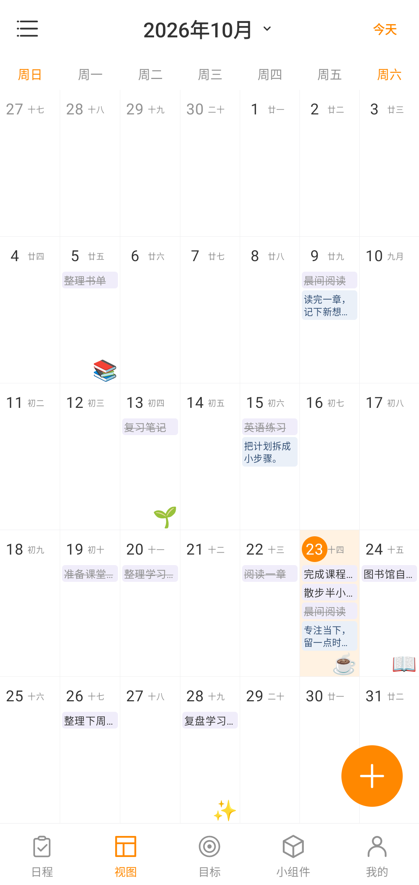
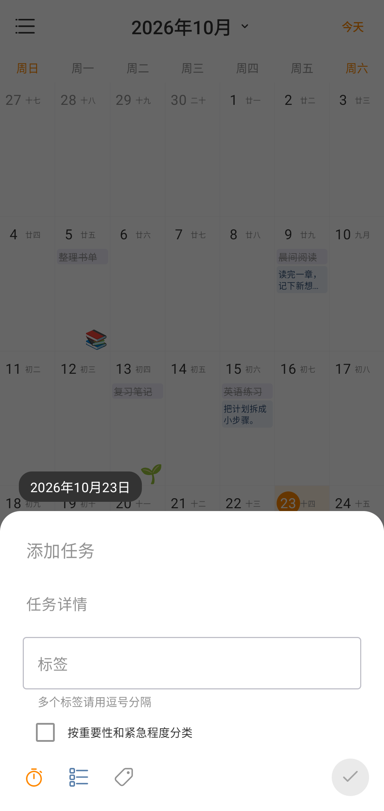
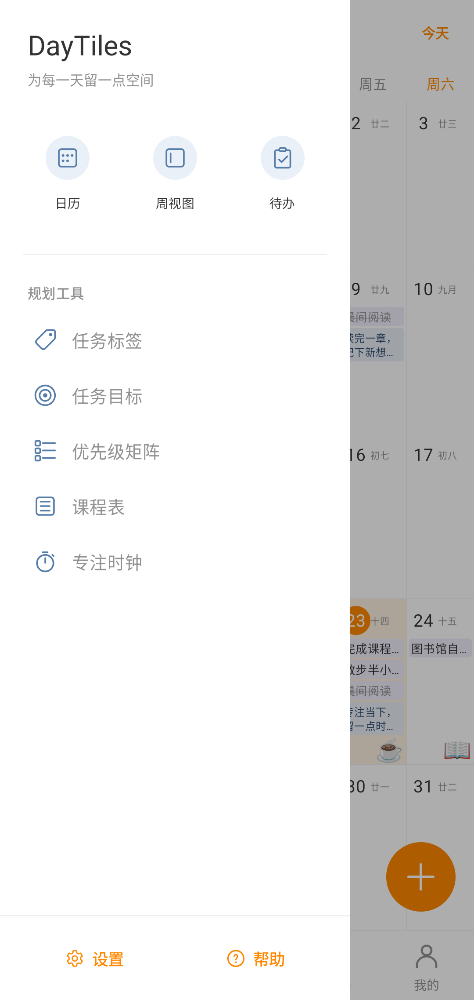
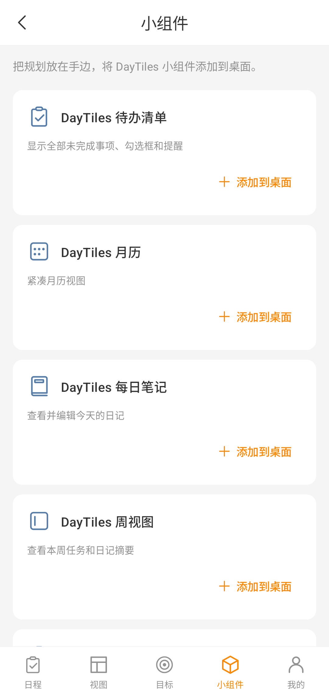
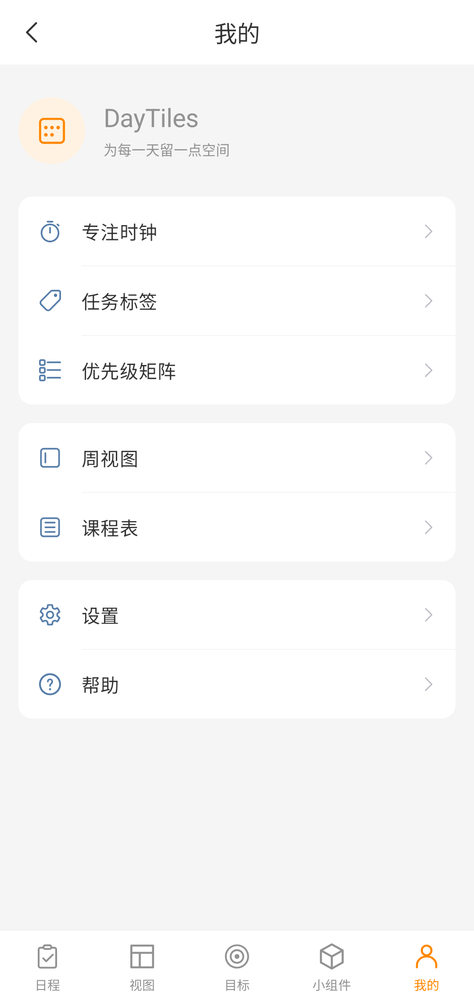
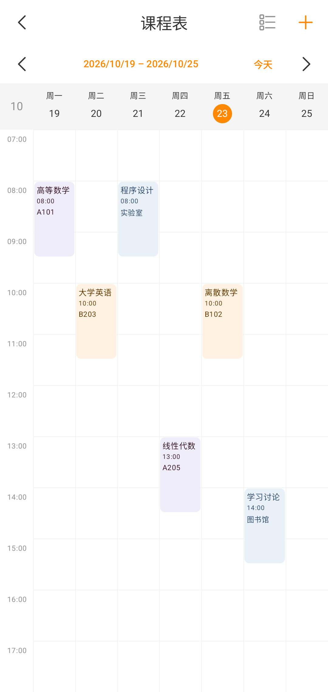
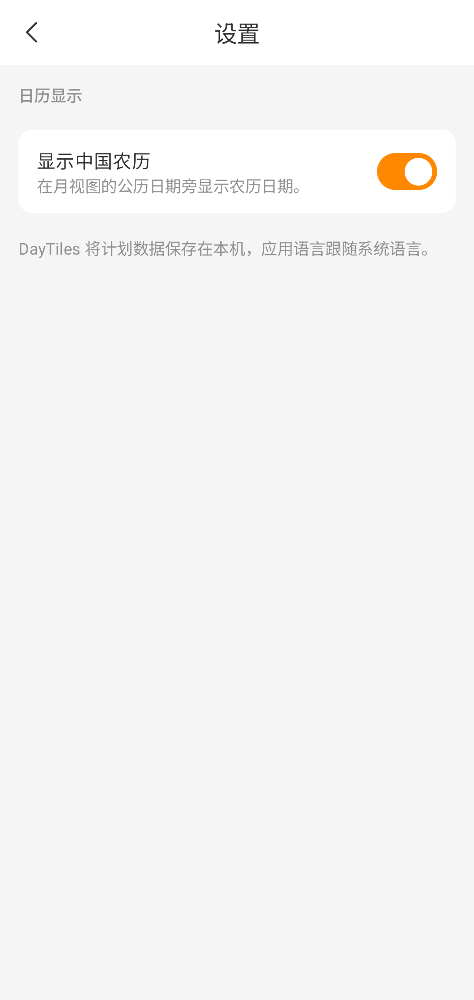
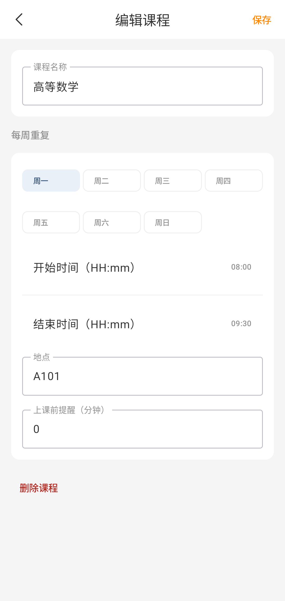

# DayTiles

[English](README.md) | [简体中文](README.zh_CN.md) | [繁體中文（香港）](README.zh_HK.md) | [繁體中文（台灣）](README.zh_TW.md)

DayTiles 是一款免费、开源、以离线使用为核心的 Android 日历、日记与可视化规划应用。你可以在月历中查看每天的日记摘要、贴纸和待办事项，也可以使用课程表、任务目标和专注时钟安排日常生活。

应用使用 Kotlin、Jetpack Compose、Room 和 Material 3 构建。无需注册账号，没有广告、订阅、统计追踪或后端服务。

## 界面预览

以下图片均来自运行简体中文界面的 Android 模拟器。截图已在模拟器内裁去系统状态栏和导航栏；日记、任务与课程内容均为专门准备的示例数据。

<table>
  <tr>
    <td align="center"><strong>月历与农历</strong><br></td>
    <td align="center"><strong>快速添加任务</strong><br></td>
  </tr>
  <tr>
    <td align="center"><strong>侧边导航</strong><br></td>
    <td align="center"><strong>任务目标</strong><br></td>
  </tr>
  <tr>
    <td align="center"><strong>桌面小组件</strong><br></td>
    <td align="center"><strong>规划工具</strong><br></td>
  </tr>
  <tr>
    <td align="center"><strong>课程表</strong><br></td>
    <td align="center"><strong>日历设置</strong><br></td>
  </tr>
  <tr>
    <td align="center"><strong>编辑课程</strong><br></td>
    <td align="center"><strong>专注时钟</strong><br></td>
  </tr>
</table>

截图的设备、语言和裁剪方式见[截图说明](docs/screenshots/zh_CN/README.md)。界面改版过程与验证记录见[外观改版里程碑](docs/redesign.md)（英文）。

## 主要功能

- **月历**：充分利用屏幕高度，以周日为每周第一天；支持左右滑动切换月份、年月选择、返回今天和相邻月份日期显示。
- **农历显示**：离线显示中国农历日期，可在设置中随时开启或关闭；偏好会保存在本机。
- **每日日记**：按日期记录文字并自动保存，在月历中预览摘要。日记与任务、贴纸分别存储。
- **任务与子任务**：快速添加任务，或在完整编辑页设置标题、详情、标签、可勾选子任务和可选提醒。
- **任务整理**：支持完成与删除、按日期分组、标签筛选、逾期提示，以及按重要性和紧急程度分类的四象限优先级矩阵。
- **任务目标**：设置每日或每周完成数量，查看进度、周日期栏和目标打卡次数。
- **贴纸**：内置 Emoji、自定义 Emoji、本地 PNG/WebP 导入，以及可选的 HTTPS 图片下载；贴纸库可重复使用，贴纸位置与具体日期关联。
- **周视图**：集中查看一周内的任务与日记摘要。
- **课程表**：在同一个每周网格中查看、新增和管理课程，支持上课时间、地点、每周重复和可选本地提醒。
- **专注时钟**：设置专注与休息时长，支持暂停、继续、自动进入休息阶段，以及关联任务。
- **桌面小组件**：提供待办清单、每日笔记、月历、周视图和专注时钟五类可调整尺寸的小组件。
- **中文界面**：默认语言为英语，并提供简体中文、繁体中文（香港）和繁体中文（台湾）本地化；应用语言随系统语言切换。
- **离线使用**：计划数据保存在本机，无需账号、云同步或后端连接。

## 使用说明

### 日历、日记与贴纸

底部提供「日程」「视图」「目标」「小组件」「我的」五个主要入口。月历中的日期格可以显示任务、日记摘要和贴纸；选择日期后，可进入当天的日记与贴纸编辑界面。

点击月历顶部的年月可选择月份，左右滑动可切换月份，点击「今天」可返回当前日期。通过「我的 → 设置 → 显示中国农历」可以控制农历标签是否显示。

农历日期由 Android 系统自带的 ICU 日历离线计算，目前不包含节气或法定节假日标注。

### 全部日程与回收站

通过侧边栏或「我的」打开「全部日程」，按日期查看所有过去和未来的任务，包括已完成任务。可以筛选完成状态、点击任务进入编辑，或点击「今天」跳转到当前日期附近。

删除任务会将其移至「回收站」并取消待触发的提醒。任务的原日期、详情、标签、完成状态和子任务会保留。恢复后，任务回到原日期；只有未完成任务仍在未来的提醒会重新安排。永久删除和清空回收站均需确认，并会一并移除相关子任务。

### 记账与预算

通过侧边栏或「我的」打开「记账与预算」，记录支出名称、日期、金额、分类及可选备注，点击记录即可编辑或删除。每日和每月模式分别显示对应期间的记录与合计，可通过日期控件查看其他期间。

每日预算和月度预算分别设置，支持零预算。摘要会显示支出、预算及剩余金额或超支金额；移除预算不会删除支出记录。可切换人民币、港币、新台币和美元账本，各币种独立统计，不会换算或修改已有记录的币种。

### 任务与目标

点击日程或视图页面的 **+** 打开快速输入面板，填写任务标题，并按需补充详情、标签、优先级和提醒。点击已有任务可进入完整编辑页，继续管理子任务和其他字段。

任务列表按日期分组，支持勾选完成和标签筛选。「目标」页面用于设置每日或每周完成任务数量；「优先级矩阵」按已设置的重要性和紧急程度展示任务。未设置优先级的任务不会自动归入象限。

### 课程表与专注时钟

通过侧边栏或「我的」打开「课程表」。点击空白时段或顶部 **+** 可新增课程，空白时段会预选对应星期和时间；点击课程块可编辑或删除课程。顶部还可切换周次或打开课程列表，重叠课程会分别显示并可单独选择。

「专注时钟」提供可配置的专注和休息时长、暂停与继续、持续通知及可选任务关联，也可以从桌面专注小组件启动。

### 添加桌面小组件

在「小组件」页面选择类型，点击「添加到桌面」，然后在桌面启动器的系统弹窗中确认。应用收到实际放置回调后才会显示添加成功。

如果启动器不支持自动添加，或没有收到添加确认，可以使用页面提供的重试与手动添加入口：返回桌面，长按空白处，打开小组件列表，找到 DayTiles 并拖动所需小组件。请为小组件留出足够的桌面空间。

| 类型 | 内容与操作 |
| --- | --- |
| 待办清单 | 查看未完成任务、日期与提醒时间，并直接勾选完成 |
| 每日笔记 | 预览今天的日记，一键打开编辑 |
| 月历 | 查看本地化紧凑月历与今天的日期高亮 |
| 周视图 | 查看本周按日期排列的任务和日记摘要 |
| 专注时钟 | 启动或查看专注计时 |

五类小组件均可调整大小，并根据可用空间展示紧凑或展开布局。

## 下载与安装

支持 Android 8.0（API 26）及以上版本。可从 [GitHub Releases](https://github.com/December172/daytiles/releases) 下载发布的 APK，也可以按下文从源码构建。

## 构建与检查

环境要求：

- JDK 17 或更高版本
- Android SDK 37
- Android SDK Build Tools 36.0.0
- 仓库内的 Gradle Wrapper，无需单独安装系统 Gradle

启动临时 Android API 37 模拟器后（连接设备测试会安装、卸载调试应用），在项目根目录运行。连接设备测试会在模拟器上执行已有单元测试，以及迁移、仓库、本地化和界面测试：

```shell
./gradlew assembleDebug
ANDROID_SERIAL=emulator-5554 ./gradlew connectedDebugAndroidTest --no-configuration-cache
./gradlew lintDebug
```

调试 APK 输出至 `app/build/outputs/apk/debug/app-debug.apk`。依赖版本集中定义在 `gradle/libs.versions.toml` 中。

迁移与测试覆盖范围见[规划与记账功能验证](docs/planner-finance.md)（英文）。

## 项目结构

```text
app/src/main/java/com/december172/daytiles/
├── data/              # Room 数据持久化与仓库
├── domain/model/      # 独立的日记、任务与贴纸模型
├── widget/            # Android 桌面小组件
└── ui/
    ├── calendar/      # 月历状态、日期算法与界面
    ├── components/    # 共用工具栏与主导航
    ├── day/           # 每日日记、任务快速输入与完整编辑
    ├── planner/       # 目标、课程表、小组件、专注时钟与规划工具
    └── theme/         # Material 3 主题
```

## 隐私与联网

DayTiles 的日历、日记、任务、课程表和专注功能均可离线使用。只有在你主动通过网址下载贴纸时才需要联网；下载的贴纸保存在应用私有的本地存储空间。

应用不要求账号，不包含广告、统计分析、追踪、云服务或后端依赖。日记、任务、贴纸和目标使用独立的数据模型，数据库升级会保留已有数据。

## 致谢

- **December172**：项目创建与维护。
- **OpenAI Codex / ChatGPT**：开发协作、功能实现、测试与文档。
- **Microsoft Fluent System Icons**：导航图标来自 [Fluent UI System Icons](https://github.com/microsoft/fluentui-system-icons)，详见[第三方许可](THIRD_PARTY_LICENSES.md)。

贡献说明见 [CONTRIBUTORS.md](CONTRIBUTORS.md)。
