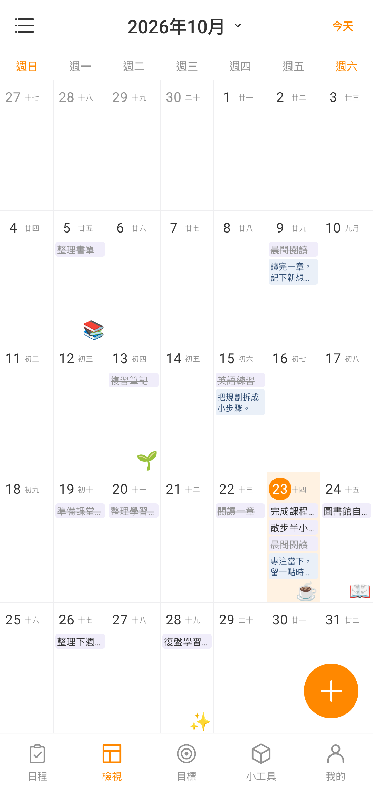
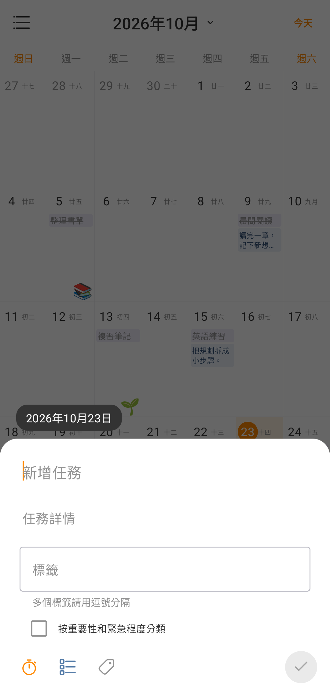
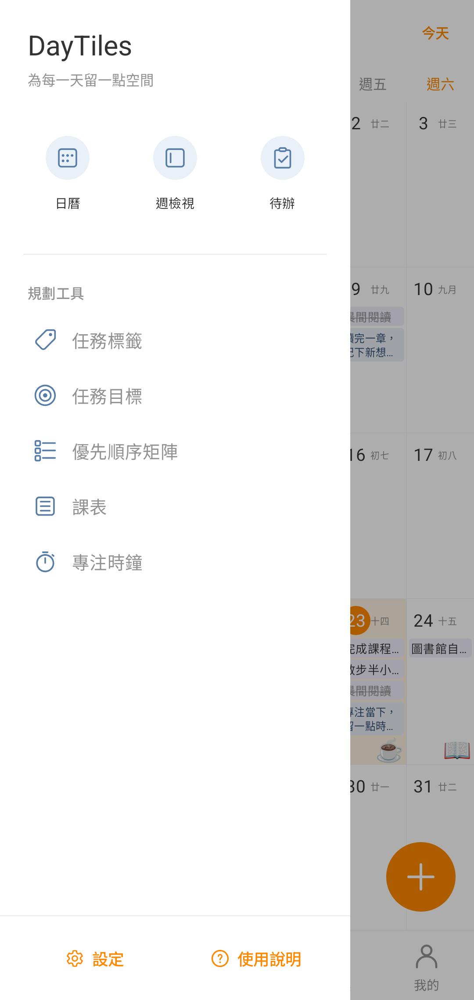
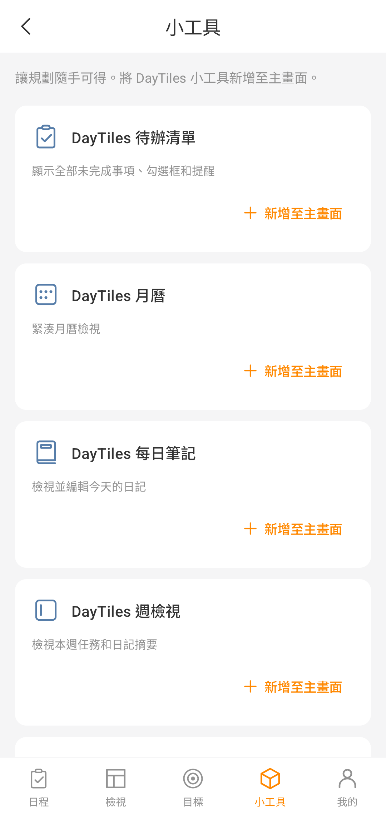
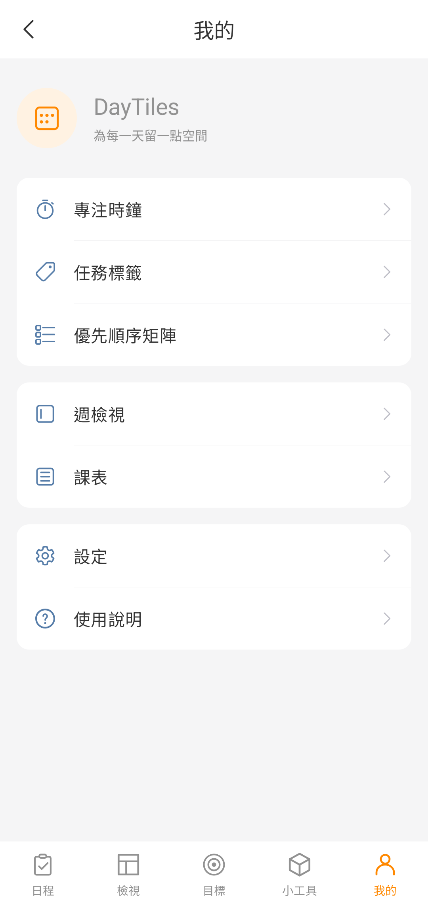
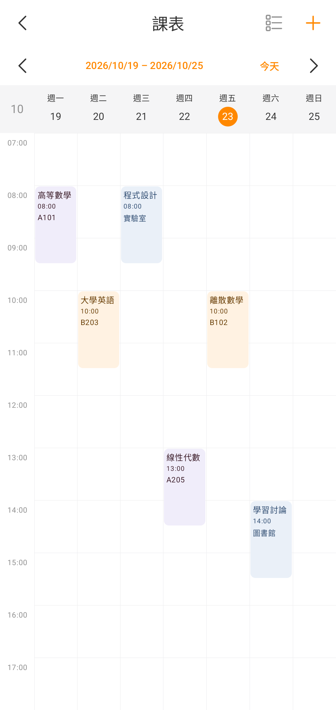
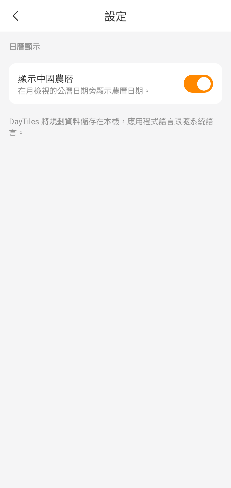
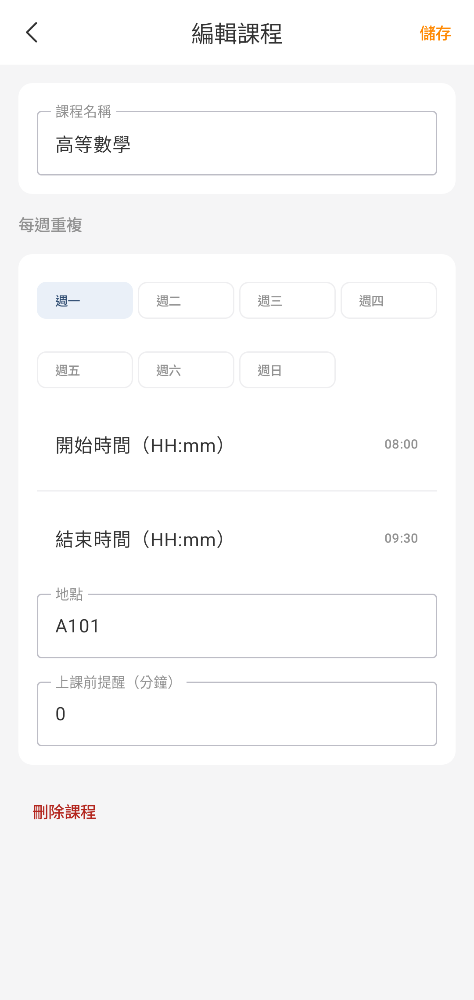

# DayTiles

[English](README.md) | [简体中文](README.zh_CN.md) | [繁體中文（香港）](README.zh_HK.md) | [繁體中文（台灣）](README.zh_TW.md)

DayTiles 是一款免費、開源、以離線使用為核心的 Android 日曆、日記與視覺化規劃應用程式。你可以在月曆中檢視每天的日記摘要、貼紙和待辦事項，也可以使用課表、任務目標和專注時鐘安排日常生活。

應用程式使用 Kotlin、Jetpack Compose、Room 和 Material 3 建置。無需註冊帳號，沒有廣告、訂閱、統計追蹤或後端服務。

## 介面預覽

以下圖片均來自執行繁體中文（台灣）介面的 Android 模擬器。截圖已在模擬器內裁去系統狀態列和導覽列；日記、任務與課程內容均為專門準備的範例資料。

<table>
  <tr>
    <td align="center"><strong>月曆與農曆</strong><br></td>
    <td align="center"><strong>快速新增任務</strong><br></td>
  </tr>
  <tr>
    <td align="center"><strong>側邊導覽</strong><br></td>
    <td align="center"><strong>任務目標</strong><br></td>
  </tr>
  <tr>
    <td align="center"><strong>主畫面小工具</strong><br></td>
    <td align="center"><strong>規劃工具</strong><br></td>
  </tr>
  <tr>
    <td align="center"><strong>課表</strong><br></td>
    <td align="center"><strong>日曆設定</strong><br></td>
  </tr>
  <tr>
    <td align="center"><strong>編輯課程</strong><br></td>
    <td align="center"><strong>專注時鐘</strong><br></td>
  </tr>
</table>

截圖的裝置、語言和裁剪方式見[截圖說明](docs/screenshots/zh_TW/README.md)。介面改版過程與驗證記錄見[外觀改版里程碑](docs/redesign.md)（英文）。

## 主要功能

- **月曆**：充分利用螢幕高度，以週日為每週第一天；支援左右滑動切換月份、年月選擇、返回今天和相鄰月份日期顯示。
- **農曆顯示**：離線顯示中國農曆日期，可在設定中隨時開啟或關閉；偏好會儲存在本機。
- **每日日記**：按日期記錄文字並自動儲存，在月曆中預覽摘要。日記與任務、貼紙分別儲存。
- **任務與子任務**：快速新增任務，或在完整編輯頁設定標題、詳情、標籤、可勾選子任務和可選提醒。
- **任務整理**：支援完成與刪除、按日期分組、標籤篩選、逾期提示，以及按重要性和緊急程度分類的四象限優先順序矩陣。
- **任務目標**：設定每日或每週完成數量，檢視進度、週日期欄和目標打卡次數。
- **貼紙**：內建 Emoji、自訂 Emoji、本地 PNG/WebP 匯入，以及可選的 HTTPS 圖片下載；貼紙庫可重複使用，貼紙位置與具體日期關聯。
- **週檢視**：集中檢視一週內的任務與日記摘要。
- **課表**：在同一個每週網格中檢視、新增和管理課程，支援上課時間、地點、每週重複和可選本地提醒。
- **專注時鐘**：設定專注與休息時長，支援暫停、繼續、自動進入休息階段，以及關聯任務。
- **主畫面小工具**：提供待辦清單、每日筆記、月曆、週檢視和專注時鐘五類可調整尺寸的小工具。
- **中文介面**：預設語言為英語，並提供簡體中文、繁體中文（香港）和繁體中文（台灣）本地化；應用程式語言隨系統語言切換。
- **離線使用**：計畫資料儲存在本機，無需帳號、雲同步或後端連線。

## 使用說明

### 日曆、日記與貼紙

底部提供「日程」「檢視」「目標」「小工具」「我的」五個主要入口。月曆中的日期格可以顯示任務、日記摘要和貼紙；選擇日期後，可進入當天的日記與貼紙編輯介面。

點選月曆頂部的年月可選擇月份，左右滑動可切換月份，點選「今天」可返回當前日期。通過「我的 → 設定 → 顯示中國農曆」可以控制農曆標籤是否顯示。

農曆日期由 Android 系統自帶的 ICU 日曆離線計算，目前不包含節氣或法定節假日標註。

### 任務與目標

點選日程或檢視頁面的 **+** 開啟快速輸入面板，填寫任務標題，並按需補充詳情、標籤、優先順序和提醒。點選已有任務可進入完整編輯頁，繼續管理子任務和其他欄位。

任務列表按日期分組，支援勾選完成和標籤篩選。「目標」頁面用於設定每日或每週完成任務數量；「優先順序矩陣」按已設定的重要性和緊急程度展示任務。未設定優先順序的任務不會自動歸入象限。

### 課表與專注時鐘

通過側邊欄或「我的」開啟「課表」。點選空白時段或頂部 **+** 可新增課程，空白時段會預選對應星期和時間；點選課程塊可編輯或刪除課程。頂部還可切換周次或開啟課程列表，重疊課程會分別顯示並可單獨選擇。

「專注時鐘」提供可設定的專注和休息時長、暫停與繼續、持續通知及可選任務關聯，也可以從主畫面專注小工具啟動。

### 新增主畫面小工具

在「小工具」頁面選擇類型，點選「新增至主畫面」，然後在主畫面啟動器的系統彈窗中確認。應用程式收到實際放置回呼後才會顯示新增成功。

如果啟動器不支援自動新增，或沒有收到新增確認，可以使用頁面提供的重試與手動新增入口：返回主畫面，長按空白處，開啟小工具列表，找到 DayTiles 並拖動所需小工具。請為小工具留出足夠的主畫面空間。

| 類型 | 內容與操作 |
| --- | --- |
| 待辦清單 | 檢視未完成任務、日期與提醒時間，並直接勾選完成 |
| 每日筆記 | 預覽今天的日記，一鍵開啟編輯 |
| 月曆 | 檢視本地化緊湊月曆與今天的日期高亮 |
| 週檢視 | 檢視本週按日期排列的任務和日記摘要 |
| 專注時鐘 | 啟動或檢視專注計時 |

五類小工具均可調整大小，並根據可用空間展示緊湊或展開佈局。

## 下載與安裝

支援 Android 8.0（API 26）及以上版本。可從 [GitHub Releases](https://github.com/December172/daytiles/releases) 下載釋出的 APK，也可以按下文從原始碼建置。

## 建置與檢查

環境要求：

- JDK 17 或更高版本
- Android SDK 37
- Android SDK Build Tools 36.0.0
- 倉庫內的 Gradle Wrapper，無需單獨安裝系統 Gradle

在專案根目錄執行：

```shell
./gradlew assembleDebug
./gradlew testDebugUnitTest
./gradlew lintDebug
```

除錯 APK 輸出至 `app/build/outputs/apk/debug/app-debug.apk`。依賴版本集中定義在 `gradle/libs.versions.toml` 中。

## 專案結構

```text
app/src/main/java/com/december172/daytiles/
├── data/              # Room 資料持久化與倉庫
├── domain/model/      # 獨立的日記、任務與貼紙模型
├── widget/            # Android 主畫面小工具
└── ui/
    ├── calendar/      # 月曆狀態、日期演算法與介面
    ├── components/    # 共用工具欄與主導覽
    ├── day/           # 每日日記、任務快速輸入與完整編輯
    ├── planner/       # 目標、課表、小工具、專注時鐘與規劃工具
    └── theme/         # Material 3 主題
```

## 隱私與聯網

DayTiles 的日曆、日記、任務、課表和專注功能均可離線使用。只有在你主動通過網址下載貼紙時才需要聯網；下載的貼紙儲存在應用程式私有的本地儲存空間。

應用程式不要求帳號，不包含廣告、統計分析、追蹤、雲服務或後端依賴。日記、任務、貼紙和目標使用獨立的資料模型，資料庫升級會保留已有資料。

## 致謝

- **December172**：專案建立與維護。
- **OpenAI Codex / ChatGPT**：開發協作、功能實現、測試與文件。
- **Microsoft Fluent System Icons**：導覽圖示來自 [Fluent UI System Icons](https://github.com/microsoft/fluentui-system-icons)，詳見[第三方許可](THIRD_PARTY_LICENSES.md)。

貢獻說明見 [CONTRIBUTORS.md](CONTRIBUTORS.md)。
